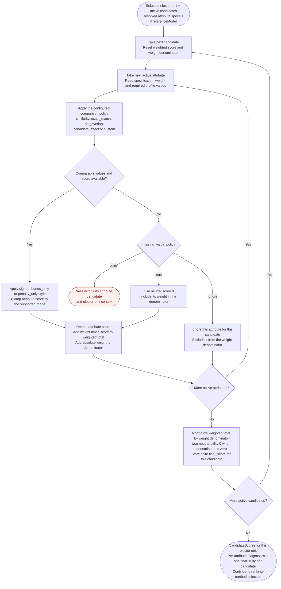

# Representational Layer: Intended Workflow

This is the design reference for the Representational Layer entrypoint discussed during PR #30 and issue #5. It describes the intended workflow, including agreed behavior and small proposed refinements. It is not a claim that every step is already implemented. Update this document when a workflow decision changes so contributors can discuss the same stages and boundaries.

The layer receives a researcher-authored JSON experiment, validates it, creates representational Python objects, generates individual ballots, and returns the candidates, ballots, and election metadata needed for simulation. It can also export that handoff as JSON. A future global orchestrator owns conversion to Simulation Layer models and starting the count.

## Master Workflow

One invocation executes one `BallotGenerationRun` for one election. The input may describe an entire experiment with several districts, elections, preference models, and runs. Use the only run when there is exactly one; otherwise require an explicit run ID. Running all runs is a separate orchestration concern.

Solid arrows describe work or outputs within the intended representational workflow. Dashed arrows describe downstream use outside this layer. Red nodes terminate the invocation with an error. A failed invocation does not return a success result or publish a new successful handoff.

```mermaid
flowchart TD
    subgraph INPUT["1. Receive and read configuration"]
        I_START(["Researcher or external caller"])
        I_REQUEST["Receive JSON path<br/>Optional run selector and export options<br/>No overrides of experiment settings"]
        I_READ["Read file and decode JSON<br/>Reject malformed JSON and duplicate keys"]
        I_OK{"Readable JSON object?"}
        I_ERROR(["Raise input error with file context<br/>Stop before model creation"])
        I_START --> I_REQUEST --> I_READ --> I_OK
        I_OK -- No --> I_ERROR
    end

    subgraph VALIDATE["2. Validate configuration and execution request"]
        V_SHAPE["Check model-derived field rules<br/>Required keys, types, supported options<br/>Collection sizes and numeric limits"]
        V_LINKS["Check IDs and relationships<br/>Resolve attribute names against config and library<br/>Check profile, weight, and custom-config rules"]
        V_RUN["Check run selection and readiness<br/>Unambiguous run and linked election<br/>At least one active candidate and elector unit"]
        V_OK{"All validation rules pass?"}
        V_ERROR(["Raise validation error with field or run context<br/>Stop: no domain objects or output"])
        V_ACCEPT["Accept configuration without modifying it<br/>Validation creates no domain models"]
        I_OK -- Yes --> V_SHAPE
        V_SHAPE --> V_LINKS --> V_RUN --> V_OK
        V_OK -- No --> V_ERROR
        V_OK -- Yes --> V_ACCEPT
    end

    subgraph BUILD["3. Build representational state and bind the run"]
        B_RESOLVE["Resolve starter attribute definitions<br/>Apply documented defaults to new values<br/>Assign inherited experiment IDs"]
        B_MODELS["Construct Experiment, Districts, Elections<br/>AttributeSpecs, Candidates, ElectorUnits<br/>PreferenceModels and BallotGenerationRuns"]
        B_STATE["Collect the typed experiment state<br/>Index objects by ID and attribute name"]
        B_BIND["Bind the selected run to its election,<br/>district, preference model and attribute specs<br/>Select active candidates and matching elector units"]
        B_SETUP["Initialize one run-local RNG from random_seed<br/>Keep stable candidate and elector-unit order<br/>Read rank cap and prepare an empty ballot collection"]
        V_ACCEPT --> B_RESOLVE --> B_MODELS --> B_STATE --> B_BIND --> B_SETUP
    end

    subgraph GENERATE["4. Generate ballots for each selected elector unit"]
        U_MORE{"Another elector unit?"}
        U_NEXT["Take next ElectorUnit<br/>Read profile and size<br/>Start an empty unit ballot batch"]
        S_SCORE["Score every active candidate once for this unit<br/>Compare each active attribute and apply missing policy<br/>Apply score style and weights; normalize final utility"]
        S_OK{"Scoring succeeded<br/>with finite scores?"}
        S_ERROR(["Raise scoring error with unit,<br/>candidate and attribute context<br/>Stop before export"])
        G_METHOD{"PreferenceModel.ranking_method"}

        D_SORT["deterministic_sort<br/>Sort candidates by descending utility<br/>Preserve input order for equal scores"]
        D_TEMPLATE["Create capped immutable rank groups<br/>Keep at most max_rankings_allowed candidates<br/>One candidate per successive rank"]
        D_BATCH["Create exactly unit.size immutable Ballots<br/>Unique ballot IDs and source/run provenance<br/>All ballots have identical rankings"]

        W_WEIGHTS["weighted_without_replacement<br/>Convert utilities to nonnegative sampling weights<br/>Use the documented score-to-weight policy"]
        T_WEIGHTS["softmax_without_replacement<br/>Convert utilities using positive temperature<br/>Use numerically stable exponential weights"]
        P_MORE{"Created unit.size ballots?"}
        P_RESET["Start one ballot's ranking<br/>Reset available candidates and rank counter"]
        P_DRAW["Draw one available candidate using the run RNG<br/>Append an immutable RankGroup<br/>Remove candidate from this ballot's pool"]
        P_LIMIT{"Rank cap reached<br/>or candidate pool empty?"}
        P_BALLOT["Construct one immutable Ballot from capped ranks<br/>Assign unique ID, generation_run_id<br/>and source_elector_unit_id"]

        U_COLLECT["Collect the completed unit batch<br/>Exactly one Ballot per represented individual<br/>Append to the election ballot collection"]

        B_SETUP --> U_MORE
        U_MORE -- Yes --> U_NEXT --> S_SCORE --> S_OK
        S_OK -- No --> S_ERROR
        S_OK -- Yes --> G_METHOD
        G_METHOD -- Deterministic --> D_SORT --> D_TEMPLATE --> D_BATCH --> U_COLLECT
        G_METHOD -- Weighted --> W_WEIGHTS --> P_MORE
        G_METHOD -- Softmax --> T_WEIGHTS --> P_MORE
        P_MORE -- No --> P_RESET --> P_DRAW --> P_LIMIT
        P_LIMIT -- No --> P_DRAW
        P_LIMIT -- Yes --> P_BALLOT --> P_MORE
        P_MORE -- Yes --> U_COLLECT
        U_COLLECT --> U_MORE
    end

    subgraph OUTPUT["5. Prepare and return the simulation-ready handoff"]
        O_VERIFY["Check generated batch invariants<br/>Ballot count equals sum of selected unit sizes<br/>Unique IDs, valid candidate references, ranks within cap"]
        O_METADATA["Derive election metadata from linked models<br/>election_id, seat_count, mode, max_ranks_allowed<br/>Create a stable elimination tie_break_order"]
        O_PROJECT["Project only simulation-required candidate and ballot fields<br/>Preserve rank and candidate_ids groups<br/>Keep research profiles and scoring state out of the payload"]
        O_OK{"Complete, valid handoff?"}
        O_ERROR(["Raise generation or handoff error<br/>Stop before publishing output"])
        O_EXPORT{"JSON export requested?"}
        O_PATH["Resolve explicit output path or default Pipe path<br/>Use the shared path helper for Pipe output"]
        O_WRITE["Serialize through the single shared JSON writer<br/>Preserve stable field and array order"]
        O_WRITTEN{"Write succeeded?"}
        O_IO_ERROR(["Raise output error with destination context<br/>Do not return a successful export result"])
        O_FILE[("Simulation-ready JSON artifact<br/>metadata + candidates + ballots")]
        O_RETURN(["Return representational result<br/>Candidates + immutable Ballots + election metadata<br/>Selected run ID + optional successful output path"])

        U_MORE -- No --> O_VERIFY --> O_METADATA --> O_PROJECT --> O_OK
        O_OK -- No --> O_ERROR
        O_OK -- Yes --> O_EXPORT
        O_EXPORT -- No --> O_RETURN
        O_EXPORT -- Yes --> O_PATH --> O_WRITE --> O_WRITTEN
        O_WRITTEN -- No --> O_IO_ERROR
        O_WRITTEN -- Yes --> O_FILE --> O_RETURN
    end

    subgraph DOWNSTREAM["Outside the Representational Layer"]
        X_ORCHESTRATOR["Future global orchestrator<br/>Receives the representational result"]
        X_ADAPTER["Shared boundary adapter<br/>Maps representational objects and metadata<br/>to Simulation Layer models"]
        X_READER["Existing simulation JSON loader<br/>Reads the file handoff"]
        X_MODELS["Simulation Candidate, Ranking, Ballot and Election<br/>Validate simulation model invariants"]
        X_COUNT["Simulation Layer runs RCV or STV<br/>Produces winners and round results"]
        O_RETURN -. In-memory integration .-> X_ORCHESTRATOR
        X_ORCHESTRATOR -.-> X_ADAPTER
        X_ADAPTER -.-> X_MODELS
        O_FILE -. File-based integration .-> X_READER
        X_READER -.-> X_MODELS
        X_MODELS -. Invoked by an external caller .-> X_COUNT
    end

    classDef failure fill:#fff0f0,stroke:#b42318,color:#7a1711;
    classDef artifact fill:#edf8f1,stroke:#27764b,color:#17482e;
    classDef external fill:#f3f4f6,stroke:#6b7280,color:#20242b;
    class I_ERROR,V_ERROR,S_ERROR,O_ERROR,O_IO_ERROR failure;
    class B_STATE,O_FILE,O_RETURN artifact;
    class X_ORCHESTRATOR,X_ADAPTER,X_READER,X_MODELS,X_COUNT external;
```

The validation diamond summarizes the phase's outcome; an implementation should raise as soon as a validation rule fails. There is no need to finish later checks after an error. The same applies to scoring, generation invariants, and output validation.

## Scoring Detail

This expands node `S_SCORE`. Run this subflow once per elector unit, before selecting a generation method. Candidate scores are intermediate representational state; they are not simulation inputs.

`candidate_effect` needs the candidate's value only. Other comparison modes generally need both candidate and elector values. An absent individual attribute value is handled by `missing_value_policy`; an entirely empty required profile is rejected during configuration validation. Malformed or unsupported values should produce a contextual validation/scoring error, not an undocumented fallback score.

## Validation and Model Creation

The target validator checks the raw configuration without mutating it or creating domain objects. Success returns normally; failure raises an error. The builder runs only after acceptance and owns default application, starter-attribute expansion, inherited IDs, and dataclass construction. Both stages should share model-derived field definitions and supported-option definitions so their rules do not drift.

| Input area | Required validation and intended construction |
| --- | --- |
| Experiment | Exactly one. User supplies its ID; description is optional. This ID is inherited by linked models that require `experiment_id`. |
| Districts and elections | At least one district; exactly one election per district. Check unique IDs and valid links, positive population and seat target, supported election mode, and a positive rank cap at least as large as the district seat target. Geometry remains optional and unused by ballot generation. |
| Attribute specs | Zero or more explicit specs. An existing starter name can supply the definition; referenced starter attributes are resolved even when not explicitly listed. New attributes require an ID, name, supported type, comparison mode, and score style. Custom comparison requires non-empty configuration for the supported custom policy. Non-custom `config` is ignored under the agreed input policy. |
| Candidates | At least one overall and at least one non-withdrawn candidate for the selected election. Validate IDs, election references, optional home district, and non-empty profiles. Withdrawn candidates do not participate in scoring or generated rankings under the current entrypoint policy. |
| Elector units | At least one overall and at least one for the selected election. Each has a unique ID, valid election reference, positive integer size, and non-empty profile. Only units belonging to the selected election contribute ballots. |
| Preference models | At least one. Require ID, name, non-empty active attributes and exactly matching weight keys, resolved attribute names, finite numeric weights and mandatory finite temperature. Apply documented defaults for omitted missing-value and ranking policies. Require positive temperature when using softmax. `parameters` defaults to an empty mapping and is ignored for now. |
| Generation runs | At least one. Validate unique run IDs, election and preference-model references, and optional seed. Run selection must resolve exactly one run; the selector chooses existing data and does not override it. |
| Generated classes | Researchers do not supply `RankGroup` or `Ballot` records. Generation creates them as immutable objects with tuple-backed nested contents. |

The validator may look up library definitions and raw records to check references; that lookup is not model construction. The builder copies resolved definitions into experiment-owned objects and preserves the supplied values unless a documented default or inherited value applies.

Do not silently invent additional research constraints. In particular, equality between district population and summed elector-unit sizes, or a requirement that candidates outnumber seats, needs an explicit project policy before becoming a rejection rule. The ballot count is determined by the sizes of the selected elector units.

## Generation Policies

| Method | Per-unit preparation | Ballot construction |
| --- | --- | --- |
| `deterministic_sort` | Score once; sort by descending final utility. Equal scores preserve input candidate order under the current policy. | Create one capped immutable ranking template and exactly `unit.size` distinct Ballots with unique IDs. They may safely share the immutable template. |
| `weighted_without_replacement` | Score once; convert utilities into sampling weights using a documented common rule. The current baseline is `offset = abs(min_score) + 1`, then `weight = score + offset`. | For each individual, reset the candidate pool, draw and remove one candidate per rank, and stop at the cap or pool exhaustion before constructing the Ballot. |
| `softmax_without_replacement` | Score once; require positive temperature. The target stable calculation is `weight = exp((score - max_score) / temperature)`, which preserves softmax probabilities while avoiding positive-exponent overflow. | Use the same per-individual sampling loop as the weighted method. A candidate cannot appear twice on one generated ballot. |

All branches use the same rank cap, ID/provenance rules, and immutable models. These methods generate consecutive ranks with one candidate per rank; equal candidate utilities do not automatically create tied rank groups. Rank-group representation is still preserved for later tie and skipped-rank support.

The RNG belongs to the selected run and is reused across its elector units and individual ballots. Keep iteration order stable. A fixed seed, ordered input, and unchanged generation policies should reproduce stochastic output; an omitted seed does not promise reproducibility. Deterministic generation does not consume random choices.

The returned ballot count must equal the sum of selected elector-unit sizes. Candidates are scored once per unit, not once per individual ballot. Ballots are constructed within the rank limit; no later mutation or replacement is needed to repair an overlong ballot.

## Output and Boundary Mapping

The result returned to a caller should contain the selected representational candidates and ballots, complete election metadata, selected generation-run ID, and an optional successfully written output path. Including metadata is necessary for a future orchestrator to build a simulation election without rereading the source configuration. This is a proposed extension to the current result type, not a separate duplicate domain model.

File export should use the shared JSON writer and the same explicit boundary mapping that future integration will use. The JSON projection removes research-only fields; it does not instantiate Simulation Layer classes inside the Representational Layer.

| Source | Simulation-ready JSON field | Downstream use |
| --- | --- | --- |
| Selected run ID | `test_name` in the current JSON envelope | File/run identity; it is not counting policy. |
| Election ID | `metadata.election_id` | Simulation `Election.election_id` |
| Linked District seat target | `metadata.seat_count` | Simulation `Election.seat_count` |
| Election mode | `metadata.mode` | Simulation `Election.mode` |
| Election rank cap | `metadata.max_ranks_allowed` | Simulation `Election.max_ranks_allowed` |
| Documented elimination priority | `metadata.tie_break_order` | Simulation tie resolution; earlier IDs are eliminated first when tied. |
| Selected Candidate | `candidates[].candidate_id`, `withdrawn` | Simulation `Candidate` |
| Generated Ballot | `ballots[].ballot_id`, `rankings` | Simulation `Ballot` |
| Immutable RankGroup | `rankings[].rank`, `candidate_ids` | Simulation `Ranking`; tuples become JSON arrays. |

Candidate profiles, elector profiles, attributes, utilities, preference parameters, geometry, and representational ballot provenance stay outside the minimal simulation candidate/ballot records. They can remain available in representational state for research and diagnostics. The counting engine must not depend on their meaning.

Keep ballot-rank tie handling separate from simulation elimination tie-breaking. The current export baseline uses sorted active candidate IDs as the elimination priority. That policy is explicit and reproducible, but changing it or making it configurable requires a coordinated contract decision; it should never be inferred from a candidate's preference score.

For reproducible JSON, preserve defined field order, candidate and ballot order, numeric formatting, and encoding, and avoid timestamps or other incidental values in the counting payload. Validate the complete payload before writing it. A shared writer can publish via a temporary file and atomic replacement so an unsuccessful export does not replace a valid handoff with a partial document; this is a proposed persistence improvement.

## Implementation Alignment

| Responsibility | Intended owner | Relationship to current work |
| --- | --- | --- |
| Read JSON, validate fields and links, resolve model shape | Input-contract utilities | Already present, but validation currently constructs models. Separate validation from building as a follow-up. |
| Construct experiment objects and apply declared defaults | Representational state builder | Currently performed inside the parser. A distinct function can provide this boundary without adding unnecessary packages. |
| Bind one run and coordinate the layer | `Representational_Layer/main.py` | PR #30 adds this entrypoint. It should call the stages and avoid repeating contract rules. |
| Reject missing selected-election data | Validation/execution preflight | Added in the current entrypoint; the target flow moves these checks before domain model construction. |
| Compare profiles and score candidates | Existing scoring utilities | Reuse these policies. Contextual failures and finite-score checks are part of the target contract. |
| Create immutable, capped ballots | Existing generation utilities | Implemented during this review. Capping occurs before Ballot construction for all generation methods. |
| Stable, positive-temperature softmax | Generation policy and validator | Target refinement; current code still substitutes a temperature for nonpositive values and uses unstabilized exponentials. |
| Project a minimal simulation payload and export | Shared boundary/JSON utilities | Current writer serializes complete representational dataclasses. Explicit projection and one public writing path are follow-up refinements. |
| Return metadata and support execution without file export | Existing workflow result and entrypoint | Target refinement; the current entrypoint always exports and returns candidates, ballots, and a path. |
| Validate and atomically publish the final handoff | Shared boundary/JSON utilities | Proposed hardening, not a claim about the current writer. |
| Convert to simulation classes and start counting | Future global orchestrator with a shared adapter | Outside PR #30's representational entrypoint responsibility. Existing file-based simulation loading remains usable. |

## Maintaining This Reference

Use the node IDs, such as `V_RUN`, `S_SCORE`, or `O_PROJECT`, when discussing a change or opening an issue. Update the diagram, its policy notes, and the alignment table together when a decision changes. Preserve the distinction between intended behavior and implemented behavior until the related change is verified.

Changes to public inputs, run selection, scoring/ranking semantics, output fields, or ownership boundaries should be reflected here. A function rename alone does not require changing the conceptual workflow. This document is the master workflow reference; other onboarding and handoff documents should link here instead of maintaining competing charts.
