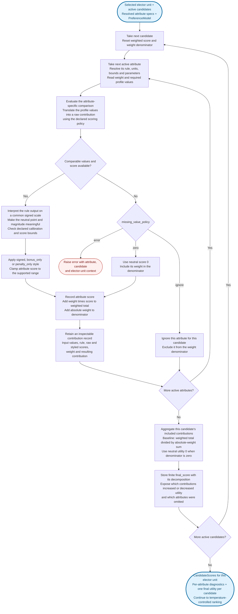

# Representational Layer: Intended Workflow

This is the design reference for the Representational Layer entrypoint discussed during PR #30 and issue #5. It describes the intended workflow, including agreed behavior and small proposed refinements. It is not a claim that every step is already implemented. Update this document when a workflow decision changes so contributors can discuss the same stages and boundaries.

The layer receives a JSON configuration and prepares one election for simulation. It scores candidates using elector-unit profiles, generates capped rankings, and returns candidates, ranking counts, and election metadata. A future orchestration layer prepares inputs for multiple elections, calls the Representational Layer once per election, and coordinates simulation and collection of results.

## Simplification Decisions

1. **One district and one election per call.** Run the layer again with a different input to model another election. A future orchestrator owns experiment expansion and coordination across calls.
2. **Retain the existing input infrastructure.** Use one district, election, preference model, and generation run in working configurations. The parser still reads the experiment-shaped input, and the entrypoint executes one run per call. This is an operating convention for current work.
3. **Share one preference model across elector units.** Each unit supplies its own profile. The shared model supplies the active attributes, weights, missing-value policy, and temperature. Profiles drive differences in baseline utilities, and positive temperature allows variation among ballots within a unit.
4. **Use one temperature-controlled ranking rule.** Sort `utility + temperature * gumbel_noise` and apply the rank cap. At zero temperature, skip random draws and sort the baseline utilities with a stable tie rule. Positive temperature uses independent Gumbel noise per candidate per ballot and produces the sequential softmax ranking distribution. `ranking_method` becomes redundant under this target policy.
5. **Accumulate counts by ranking.** Add the entire unit size to one count at zero temperature. At positive temperature, sample a ranking and immediately increment its count. A sparse map of observed rankings avoids allocating slots for every possible ranking.
6. **Define the provenance and counting tradeoffs.** Election-wide counts omit the source elector unit. Counts keyed by unit and ranking could preserve it at a higher memory cost. The Simulation Layer needs to consume multiplicities directly to retain the savings and apply STV transfer truncation at the per-ballot level.

## Master Workflow

The solid boundary encloses one Representational Layer invocation. A caller can supply a configuration directly today. The future orchestration layer can supply a series of single-election configurations and receive one result per call.

Solid arrows describe work or outputs for one invocation. Dashed arrows show future orchestration or integration. Amber nodes belong to future orchestration, and red nodes terminate the invocation with an error. A failed invocation does not return a success result or publish a new successful handoff.

The blue, double-bordered scoring box represents a subprocess expanded in the separate [Scoring Detail diagram](#scoring-detail) below. Its internal loops and policies are maintained there.

```mermaid
flowchart TD
    subgraph FUTURE["Future orchestration layer: experiment planning"]
        F_PLAN["Choose districts, elections and model scenarios<br/>Prepare a separate configuration for each run"]
        F_CALL["Invoke the Representational Layer<br/>once per single-election configuration"]
        F_PLAN -.-> F_CALL
    end

    subgraph REPRESENTATION["Representational Layer: one district, one election, one preference model per call"]
    subgraph INPUT["1. Receive and read configuration"]
        I_REQUEST["Receive a single-election JSON configuration<br/>Keep the existing experiment-shaped input contract<br/>Accept existing export options"]
        I_READ["Read file and decode JSON<br/>Reject malformed JSON and duplicate keys"]
        I_OK{"Readable JSON object?"}
        I_ERROR(["Raise input error with file context<br/>Stop before model creation"])
        I_REQUEST --> I_READ --> I_OK
        I_OK -- No --> I_ERROR
    end

    subgraph VALIDATE["2. Validate configuration and execution request"]
        V_SHAPE["Check model-derived field rules<br/>Required keys, types, supported options<br/>Collection sizes and numeric limits"]
        V_LINKS["Check IDs and relationships<br/>Resolve attribute names against config and library<br/>Check profile, weight, and custom-config rules"]
        V_RUN["Check the run and linked records<br/>At least one active candidate and elector unit<br/>Validate temperature for the ranking policy"]
        V_OK{"All validation rules pass?"}
        V_ERROR(["Raise validation error with field or run context<br/>Stop: no domain objects or output"])
        V_ACCEPT["Accept configuration without modifying it<br/>Validation creates no domain models"]
        I_OK -- Yes --> V_SHAPE
        V_SHAPE --> V_LINKS --> V_RUN --> V_OK
        V_OK -- No --> V_ERROR
        V_OK -- Yes --> V_ACCEPT
    end

    subgraph BUILD["3. Build representational state and bind the run"]
        B_RESOLVE["Resolve starter attribute definitions<br/>Apply documented defaults to new values<br/>Assign inherited experiment IDs"]
        B_MODELS["Construct typed records using the existing model structure<br/>Resolve one district, election, preference model and run"]
        B_BIND["Bind active candidates and elector units to the election<br/>Use one shared preference model for all units"]
        B_SETUP["Read rank cap and prepare an empty ranking count map<br/>Keep stable candidate and elector-unit order<br/>Initialize a run-local RNG for positive temperature"]
        V_ACCEPT --> B_RESOLVE --> B_MODELS --> B_BIND --> B_SETUP
    end

    subgraph GENERATE["4. Score each elector unit and accumulate ranking counts"]
        U_MORE{"Another elector unit?"}
        U_NEXT["Take next ElectorUnit<br/>Read its profile and size<br/>Use the shared preference model"]
        S_SCORE[["Attribute scoring and candidate utility<br/>Compare, calibrate, weight and aggregate<br/>See the separate Scoring Detail diagram below"]]
        S_OK{"Scoring succeeded<br/>with finite scores?"}
        S_ERROR(["Raise scoring error with unit,<br/>candidate and attribute context<br/>Stop before export"])
        G_TEMPERATURE{"Temperature equals zero?"}
        G_BASE["Use baseline utilities directly<br/>One ranking represents the whole unit"]
        G_NOISE["Draw independent Gumbel noise per candidate<br/>For this draw, use utility + temperature * noise"]
        G_SORT["Sort scores in descending order<br/>Keep input order for exact ties<br/>Apply the rank cap and form a rank-group key"]
        G_ADD["Increment this ranking's election-wide count<br/>Add unit.size at zero temperature<br/>Add 1 for a positive-temperature draw"]
        G_MORE{"More draws needed for this unit?"}

        B_SETUP --> U_MORE
        U_MORE -- Yes --> U_NEXT --> S_SCORE --> S_OK
        S_OK -- No --> S_ERROR
        S_OK -- Yes --> G_TEMPERATURE
        G_TEMPERATURE -- Yes --> G_BASE --> G_SORT
        G_TEMPERATURE -- Positive temperature --> G_NOISE --> G_SORT
        G_SORT --> G_ADD --> G_MORE
        G_MORE -- Yes --> G_NOISE
        G_MORE -- No --> U_MORE
    end

    subgraph OUTPUT["5. Prepare and return the simulation-ready handoff"]
        O_VERIFY["Check ranking counts and references<br/>Positive integer counts sum to all unit sizes<br/>Distinct ranking keys and ranks within cap"]
        O_METADATA["Derive election metadata from linked models<br/>election_id, seat_count, mode, max_ranks_allowed<br/>Create a stable elimination tie_break_order"]
        O_PROJECT["Project candidates, ranking counts and metadata<br/>Preserve rank and candidate_ids groups<br/>Include a count for each distinct ranking"]
        O_OK{"Complete, valid handoff?"}
        O_ERROR(["Raise generation or handoff error<br/>Stop before publishing output"])
        O_EXPORT{"JSON export requested?"}
        O_PATH["Resolve explicit output path or default Pipe path<br/>Use the shared path helper for Pipe output"]
        O_WRITE["Serialize through the single shared JSON writer<br/>Preserve stable field and array order"]
        O_WRITTEN{"Write succeeded?"}
        O_IO_ERROR(["Raise output error with destination context<br/>Do not return a successful export result"])
        O_FILE[("Target count-aware JSON handoff<br/>Metadata, candidates and ranked ballot counts")]
        O_RETURN(["Return one election result<br/>Candidates, ranking counts and election metadata<br/>Run ID and optional output path"])

        U_MORE -- No --> O_VERIFY --> O_METADATA --> O_PROJECT --> O_OK
        O_OK -- No --> O_ERROR
        O_OK -- Yes --> O_EXPORT
        O_EXPORT -- No --> O_RETURN
        O_EXPORT -- Yes --> O_PATH --> O_WRITE --> O_WRITTEN
        O_WRITTEN -- No --> O_IO_ERROR
        O_WRITTEN -- Yes --> O_FILE --> O_RETURN
    end
    end

    I_START(["Researcher supplies one configuration"]) --> I_REQUEST
    F_CALL -. One call per configuration .-> I_REQUEST

    subgraph DOWNSTREAM["Future count-aware simulation handoff"]
        X_ADAPTER["Orchestration adapter maps one result<br/>to Simulation Layer models with counts"]
        X_READER["Shared JSON loader reads rankings and counts"]
        X_MODELS["Validate one simulation election<br/>Keep counts on grouped rankings"]
        X_COUNT["Run RCV or STV using multiplicities<br/>Preserve per-ballot STV transfer truncation"]
        O_RETURN -. In-memory integration .-> X_ADAPTER
        X_ADAPTER -.-> X_MODELS
        O_FILE -. File-based integration .-> X_READER
        X_READER -.-> X_MODELS
        X_MODELS -. Invoked by an external caller .-> X_COUNT
    end
    F_RESULTS["Future orchestration layer<br/>Collect and compare results across invocations"]
    X_COUNT -. One simulation result .-> F_RESULTS

    classDef failure fill:#fff0f0,stroke:#b42318,color:#7a1711;
    classDef artifact fill:#edf8f1,stroke:#27764b,color:#17482e;
    classDef external fill:#f3f4f6,stroke:#6b7280,color:#20242b;
    classDef detailed fill:#e0f2fe,stroke:#0369a1,stroke-width:3px,color:#0c4a6e;
    classDef orchestration fill:#fff4db,stroke:#9a6700,stroke-dasharray:5 3,color:#573900;
    class I_ERROR,V_ERROR,S_ERROR,O_ERROR,O_IO_ERROR failure;
    class O_FILE,O_RETURN artifact;
    class X_ADAPTER,X_READER,X_MODELS,X_COUNT external;
    class S_SCORE detailed;
    class F_PLAN,F_CALL,F_RESULTS orchestration;
    style FUTURE fill:#fffbef,stroke:#9a6700,stroke-dasharray:5 3
    style REPRESENTATION fill:#f8fafc,stroke:#475569,stroke-width:2px
```

The validation diamond summarizes the phase's outcome; an implementation should raise as soon as a validation rule fails. There is no need to finish later checks after an error. The same applies to scoring, generation invariants, and output validation.

## Scoring Detail

This expands the blue `S_SCORE` subprocess box in Step 4 of the master diagram. Matching blue entry and exit nodes mark the detailed subflow's boundaries. Attribute scoring and utility construction are a central research and engineering feature of the layer. Run this subflow once per elector unit using the shared preference model, then pass the candidate utilities to the ranking policy.

The engineering task is to define how profile information becomes a meaningful contribution to preference, then how those contributions jointly describe preference for a candidate. A shared numeric range alone does not make different attributes equally meaningful. The model needs explicit definitions for score direction, neutral values, distance or effect scales, missing data, relative importance, and aggregation. The diagram names these responsibilities without treating the current formulas as a finished behavioral model.

`candidate_effect` needs the candidate's value only. Other comparison modes generally need both candidate and elector values. An absent individual attribute value is handled by `missing_value_policy`; an entirely empty required profile is rejected during configuration validation. Malformed or unsupported values should produce a contextual validation/scoring error, not an undocumented fallback score.

### Scoring Responsibilities and Open Design Work

| Responsibility | What must be engineered and evaluated |
| --- | --- |
| Attribute meaning and comparison | Define required inputs, units, comparison behavior and rule parameters for each attribute. Identify what makes a comparison favorable, neutral, unfavorable or undefined. An attribute's storage type alone is insufficient to determine its preference semantics. |
| Score calibration | Define the contribution scale and the meaning of its magnitude. Check whether contributions from different attributes are comparable before applying preference weights. Clamping to a common range limits values but does not establish that comparability. |
| Missing information | Preserve the distinction between missing, ignored, and genuinely neutral comparisons. Make the resulting change to the aggregation denominator visible. |
| Preference weights | Define what a weight expresses after score calibration. Keep score-scale choices separate from importance weights so changing units or bounds does not silently change the research interpretation. |
| Utility aggregation | The current normalized weighted sum is an explicit baseline. It assumes additive contributions and allows a favorable attribute to compensate for an unfavorable one. Attribute interactions, thresholds, or non-compensatory rules require a research decision and implementation; they are not supported merely by changing weights. |
| Explainability | Retain enough information to reconstruct a candidate's utility from its inputs, scoring rules, contributions, weights, and missing-data decisions. The richer trace shown here is intended behavior; the current scorer returns attribute scores and a final score. |
| Model evaluation | Check known comparison examples, boundary cases, and missing-value behavior. Evaluate sensitivity to scales and weights, and compare predicted preferences with suitable research evidence when available. Passing arithmetic tests does not establish behavioral validity. |

For the baseline aggregator, utility is `sum(weight * attribute_score) / sum(abs(weight))` over included attributes. An ignored attribute is excluded from both sums; a neutral zero score still contributes its absolute weight to the denominator. A zero denominator yields neutral utility. These are explicit model assumptions to review, not incidental implementation details.

Rule selection, calibration, and aggregation must use declared policies, rather than new undocumented defaults in the entrypoint. The stages in the diagram describe responsibilities; they do not require a separate class or file for every box. Existing comparison helpers already perform some normalization, so implementing this design must avoid applying the same transformation twice.

## Validation and Model Creation

Keep the existing JSON input structure, model classes, and parser for single-election work. Today the parser validates the full contract and constructs model objects, and the entrypoint executes one generation run. The diagram separates validation from model construction conceptually. A dedicated validation stage remains a possible refinement independent of the single-election convention.

| Input area | Required validation and intended construction |
| --- | --- |
| Experiment | Exactly one. User supplies its ID; description is optional. This ID is inherited by linked models that require `experiment_id`. |
| Districts and elections | Supply one district and its election in the existing collections. Check IDs and links, positive population and seat target, supported election mode, and a positive rank cap at least as large as the district seat target. Geometry remains optional. |
| Attribute specs | Zero or more explicit specs. An existing starter name can supply the definition; referenced starter attributes are resolved even when not explicitly listed. New attributes require an ID, name, supported type, comparison mode, and score style. Custom comparison requires non-empty configuration for the supported custom policy. Non-custom `config` is ignored under the agreed input policy. |
| Candidates | At least one overall and at least one non-withdrawn candidate for the selected election. Validate IDs, election references, optional home district, and non-empty profiles. Withdrawn candidates do not participate in scoring or generated rankings under the current entrypoint policy. |
| Elector units | At least one overall and at least one for the selected election. Each has a unique ID, valid election reference, positive integer size, and non-empty profile. Only units belonging to the selected election contribute ballots. |
| Preference models | Supply one shared model with ID, name, non-empty active attributes, exactly matching weight keys, resolved attribute names, and finite numeric weights. The target ranking policy accepts finite `temperature >= 0`. Today's schema still requires positive temperature and accepts `ranking_method`. Apply documented missing-value defaults. |
| Generation runs | Supply one run linking the election and preference model, with an optional seed. The entrypoint can execute that run directly. |
| Generated rankings | The generator constructs capped rank-group keys and integer counts. These records are outputs derived from elector units. |

The validator may look up library definitions and raw records to check references; that lookup is not model construction. The builder copies resolved definitions into experiment-owned objects and preserves the supplied values unless a documented default or inherited value applies.

Do not silently invent additional research constraints. In particular, equality between district population and summed elector-unit sizes, or a requirement that candidates outnumber seats, needs an explicit project policy before becoming a rejection rule. The ballot count is determined by the sizes of the selected elector units.

## Ranking and Aggregation

Compute baseline candidate utilities once per elector unit. Use one ranking rule with `temperature` as its only control. Validate that temperature is finite and nonnegative. Both cases use a stable descending sort, preserve input order for exact ties, and retain candidates up to the rank cap as successive rank groups.

| Temperature | Scores passed to the sort | Update to the ranking count |
| --- | --- | --- |
| Zero | Baseline utilities. Sort once for the entire unit and skip RNG draws. | Add `unit.size` to the resulting ranking. |
| Positive | For each represented voter, draw an independent standard Gumbel value `g` per candidate and sort `utility + temperature * g`. | Add `1` immediately after each draw. Repeat for `unit.size` draws. |

Keep the baseline utilities for scoring diagnostics. For positive temperature, Gumbel perturbation and sorting produce the same ranking distribution as sequential softmax sampling without replacement. The run-local RNG continues across elector units and ballots. A fixed seed and stable iteration order reproduce results for the same implementation. [Gumbel-top-k result](https://proceedings.mlr.press/v97/kool19a.html)

Key counts by the complete capped rank-group sequence, including each rank and its candidate IDs. A dense index is possible when the ranking space is small. Four candidates ranked three deep yield `4 * 3 * 2 = 24` possible generated rankings. A sparse map grows with the number of observed rankings and avoids allocating space for unused possibilities. The sum of the counts must equal the sum of elector-unit sizes. Positive temperature still requires a draw per represented voter under this design.

Election-wide counts combine contributions from different elector units. This discards the source unit for each contribution. A map keyed by `(elector_unit_id, ranking)` would preserve that information and could contain more entries. The main workflow uses election-wide counts.

## Output and Boundary Mapping

The target result contains one election's candidates, ranking counts, election metadata, generation-run ID, and an optional successfully written output path. Metadata lets an orchestrator construct a simulation election from the result directly. A future orchestrator can prepare and submit separate configurations, pass each result to simulation, and compare outcomes across calls.

File export should use the shared JSON writer and the same explicit boundary mapping that future integration will use. The JSON projection removes research-only fields; it does not instantiate Simulation Layer classes inside the Representational Layer.

| Source | Simulation-ready JSON field | Downstream use |
| --- | --- | --- |
| Selected run ID | `test_name` in the current JSON envelope | File/run identity; it is not counting policy. |
| Election ID | `metadata.election_id` | Simulation `Election.election_id` |
| Linked District seat target | `metadata.seat_count` | Simulation `Election.seat_count` |
| Election mode | `metadata.mode` | Simulation `Election.mode` |
| Election rank cap | `metadata.max_ranks_allowed` | Simulation `Election.max_ranks_allowed` |
| Documented elimination priority | `metadata.tie_break_order` | Simulation tie resolution; earlier IDs are eliminated first when tied. |
| Selected Candidate | `candidates[].candidate_id`, `withdrawn` | Simulation `Candidate` |
| Grouped ranking | `ballots[].ballot_id`, `rankings`, proposed `count` | One simulation ballot record per distinct ranking, with a positive integer multiplicity. A missing `count` can default to `1` for existing files. |
| Immutable RankGroup | `rankings[].rank`, `candidate_ids` | Simulation `Ranking`; tuples become JSON arrays. |

Candidate profiles, elector profiles, attributes, utilities, preference parameters, and geometry remain representational data. The count-aware handoff requires Simulation Layer support to tally grouped rankings directly. For STV, retain a transfer value per represented ballot, apply the existing four-decimal truncation to that value, and multiply the resulting value by the group count when tallying. A group can share one transfer value and activity state while its members have identical ranking and transfer histories. Verify round totals and winners against the equivalent individual ballots before adopting grouped counting.

Keep ballot-rank tie handling separate from simulation elimination tie-breaking. The current export baseline uses sorted active candidate IDs as the elimination priority. That policy is explicit and reproducible, but changing it or making it configurable requires a coordinated contract decision; it should never be inferred from a candidate's preference score.

For reproducible JSON, preserve defined field order, candidate and ballot order, numeric formatting, and encoding, and avoid timestamps or other incidental values in the counting payload. Validate the complete payload before writing it. A shared writer can publish via a temporary file and atomic replacement so an unsuccessful export does not replace a valid handoff with a partial document; this is a proposed persistence improvement.

## Implementation Alignment

| Responsibility | Intended owner | Relationship to current work |
| --- | --- | --- |
| Read JSON, validate fields and links, and build model objects | Existing input-contract utilities | Retain the current parser and experiment-shaped contract. Use single-election inputs as a working convention. |
| Execute one election with one shared preference model | `Representational_Layer/main.py` | The existing entrypoint executes one run and uses that run's preference model for every elector unit. |
| Reject missing selected-election data | Validation/execution preflight | Added in the current entrypoint; the target flow moves these checks before domain model construction. |
| Compare attributes, calibrate contributions, and construct candidate utility | Existing scoring utilities and declared scoring specifications | Central feature to develop and evaluate. Existing comparison policies and a normalized weighted sum provide the baseline; explicit calibration, richer contribution traces, contextual failures and finite-score checks are target refinements. |
| Rank with temperature and Gumbel noise | Generation utilities and validator | Target policy. Current generation still uses separate deterministic, shifted-weight, and sequential softmax methods. |
| Aggregate identical capped rankings | Representational generation | Target optimization. The current generator returns one `Ballot` per represented voter. |
| Tally ranking counts and apply per-ballot STV truncation | Simulation Layer and shared JSON contract | Future count-aware handoff. The current loader and counter use individual ballot records. |
| Project a minimal simulation payload and export | Shared boundary/JSON utilities | Current writer serializes complete representational dataclasses. Explicit projection and one public writing path are follow-up refinements. |
| Return metadata and support execution without file export | Existing workflow result and entrypoint | Target refinement; the current entrypoint always exports and returns candidates, ballots, and a path. |
| Validate and atomically publish the final handoff | Shared boundary/JSON utilities | Proposed hardening, not a claim about the current writer. |
| Coordinate multiple elections and collect simulation results | Future orchestration layer with a shared adapter | Prepare one configuration per election, invoke representation and simulation for each, and collect the results. |

## Maintaining This Reference

Use the node IDs, such as `V_RUN`, `S_SCORE`, or `O_PROJECT`, when discussing a change or opening an issue. Update the diagram, its policy notes, and the alignment table together when a decision changes. Preserve the distinction between intended behavior and implemented behavior until the related change is verified.

Changes to public inputs, run selection, scoring/ranking semantics, output fields, or ownership boundaries should be reflected here. A function rename alone does not require changing the conceptual workflow. This document is the master workflow reference; other onboarding and handoff documents should link here instead of maintaining competing charts.
